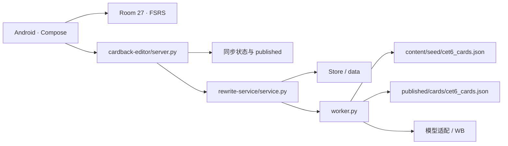

# wordhelper 架构导览

| 路径 | 模块职责 |
|---|---|
| app/src_repo/ | Gradle 根；app/src/main 实现 Kotlin/Compose 客户端，test 与 androidTest 分别用于 JVM、设备测试 |
| content/seed/、content/words/ | 种子卡片与词库资源 |
| tools/cardback-editor/ | HTTP/TLS、编辑器静态资源、同步与发布 |
| tools/rewrite-service/ | 重写协议、队列、持久化、反馈和供应商适配 |
| tools/word-audit/ | 离线词卡扫描与复核 |
| scripts/ | 门禁、模拟器验收与词性检查 |
| docs/ | 架构、兼容约定、测试夹具及设计和运维资料 |
| _toolchain/、venv-anki | 本机工具、签名及外部环境联接；保持路径稳定 |

## CardBack 内部模块

server.py 保留启动入口、GET/POST 路由、兼容符号与运行态。它将同一份上下文传给处理器和辅助函数，各模块均可独立导入。

| 模块 | 职责 |
|---|---|
| cardback_security.py | 口令与身份、可信来源、限流预算与入站检查 |
| cardback_config.py | 配置校验、版本历史、发布与回滚 |
| cardback_api.py | 编辑器、词卡包、同步、健康与身份接口 |
| cardback_http.py | HTTP 请求体与响应、静态文件和缺页提示 |
| cardback_rewrite.py | 重写模块查找与缓存、能力探测、同源转发和启动 |
| cardback_network.py | 网卡探测、TLS 监听生命周期、UDP 发现 |
| cardback_startup.py | 命令行解析、启动顺序与退出清理 |

## 请求与数据流

CardBack 监听 8765/8443，负责鉴权、同步、发布与同源转发。server.py 的 _rewrite_module 查找 BASE_DIR/rewrite-service 和 BASE_DIR/../rewrite-service。源码部署需要两个 tools 子目录并列；打包部署依赖可执行文件旁的模块目录。
启动时 _start_rewrite 调用 startup()；/rewrite* 与 /models 由 respond(method, path, body) 分派。探测能力与启动队列应分别验证。
service.py 初始化 Store 与工作线程。REWRITE_DATA_DIR 可指定隔离目录；生产队列、锁和反馈默认位于 rewrite-service/data/。
worker.py 以仓库根下的 content/seed/cet6_cards.json 与 tools/cardback-editor/published/cards/cet6_cards.json 补全词条。迁移模块须验证两处相对路径。
providers.py 适配模型，WB 经 8788。测试使用假供应商。AppDatabase.kt 注册 Room 历史迁移；UI 或同步重构须保留学习进度与记忆状态的兼容性。

## LearningScreen 内部模块

同包内保留页面订阅与副作用，指针适配器将像素输入交给纯 Kotlin 判定。

| 文件 | 职责 |
|---|---|
| LearningScreen.kt | 页面入口、订阅、可保存状态、生命周期与事件连线 |
| LearningStudyLayout.kt | 背景、菜单、双抽屉缩放、识别/拼写布局、进度与叠层顺序 |
| LearningSessionStatus.kt | 等待、完成打卡与复习压力提示 |
| LearningDialogs.kt | 移出、AI 引导、编辑思路与复习时间对话框 |
| LearningAssistance.kt | AI 替换页、发音播放与卡背重写回调 |
| LearningWordCard.kt | 卡面布局、翻书动画、交互门控与卡背滚动状态 |
| LearningCardDetails.kt | 自适应词头、卡面图标、复习时间及方法标签 |
| LearningCardBackBlocks.kt | 块顺序、间距、滚动渐隐、语义色与字号覆盖 |
| LearningMemoryContent.kt | 记忆正文、行内词性标记、未复核原因展开 |
| LearningMeaningContent.kt | 释义、词性颜色、双语例句及扩展词条 |
| LearningRecognitionActions.kt | 三段评分轨的绘制、触感、语义点击与跳过操作 |
| LearningScreenMotion.kt | 材质抽屉指针适配与系统动画开关 |
| LearningGestureState.kt | 纯 Kotlin 评分与抽屉手势判定，输入使用 px |
| LearningGestureStateTest.kt | 评分/抽屉移动、取消、提交、密度与异常边界 JVM 回放 |

## LearningViewModel 内部模块

| 文件 | 职责 |
|---|---|
| LearningViewModel.kt | 同包协作者装配、原有 UI 方法和状态流、viewModelScope 及启动顺序 |
| LearningSessionState.kt | 当前卡与进度、节奏、即时重试、等待集合和稳定插回 |
| LearningSessionRules.kt | 呈现代数、进度位置、恢复下标、评分降档与压力阈值的纯函数 |
| LearningSubmissionGate.kt | 共用提交闸、重入提示与 finally 复位 |
| LearningStudyFlows.kt | 书籍、设置、学习日欠卡、进度、复习压力与打卡订阅 |
| LearningCheckIn.kt | 打卡状态、连续天数与学习日欠卡计数 |
| LearningRewriteFlows.kt | 本轮请求、跳过资格、版本反馈、锁词与卡背订阅 |
| LearningQueueCoordinator.kt | 队列快照加载、欠卡恢复、逐词监听、等待轮询与同步后刷新 |
| LearningRewritePolling.kt | 卡背进度轮询、换词复位、翻面节流与终态同步 |
| LearningRewriteActions.kt | 打标、取消、撤销、跳过落库确认、停止与队列重载 |
| LearningMemoryFeedback.kt | 版本反馈、点赞累计与冲刷、记忆编辑恢复和锁词 |
| LearningAnswers.kt | 识别与拼写提交、学习进度写入、ML 特征与 FSRS 旁路 |
| LearningAiCoordinator.kt | AI 配置、缓存、例句与助记请求 |
| LearningSessionActions.kt | 重载订阅、切书、生词本、压力分散与打卡 |
| LearningSessionContractTest.kt | 队列、重试、恢复、呈现、降档与压力阈值 JVM 回放 |

## 拆分优先级

按 2026-11-23 体检的物理行数排序分批。当前明细由门禁输出。

| 顺序 | 文件 | 行数 | 首个边界与验证 |
|---|---|---:|---|
| 1 | LearningScreen.kt | 432 | 已完成瘦身；评分与抽屉状态机由双 flavor JVM 回放覆盖 |
| 2 | LearningViewModel.kt | 207 | 已拆分，双 flavor JVM 回放覆盖会话推进、评分重试与恢复 |
| 3 | cardback-editor/server.py | 436 | 已完成瘦身，入口保留路由与兼容状态；模块边界测试覆盖同源转发、健康与导入 |
| 4 | RewriteRepository.kt | 2066 | 隔离提交、取消与轮询，验证已有任务恢复 |
| 5 | pipeline.py | 1575 | 拆分生成与结构校验，以固定输入回放 |
| 6 | SyncRepository.kt | 1451 | 用状态机覆盖网络回退、冲突与重试 |
| 7 | WordRepository.kt | 1375 | 分离词库查询与学习写入，保留事务边界 |
| 8 | store.py | 1281 | 区分队列与持久化，验证崩溃恢复及旧数据兼容 |
