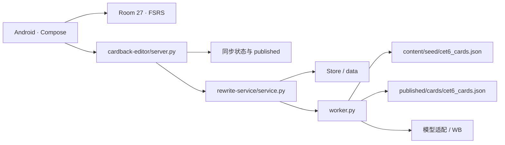

# wordhelper 架构导览

| 路径 | 模块职责 |
|---|---|
| app/src_repo/ | Gradle 根；app/src/main 实现 Kotlin/Compose 客户端，test 与 androidTest 分别用于 JVM、设备测试 |
| content/seed/、content/words/ | 种子卡片与词库资源 |
| tools/cardback-editor/ | HTTP/TLS、编辑器静态资源、同步与发布 |
| tools/rewrite-service/ | 重写协议、队列、持久化、反馈和供应商适配 |
| tools/word-audit/ | 离线词卡扫描与复核 |
| scripts/ | 门禁、模拟器验收与词性检查 |
| docs/ | 架构、兼容约定、测试夹具及设计和运维资料 |
| _toolchain/、venv-anki | 本机工具、签名及外部环境联接；保持路径稳定 |

## CardBack 内部模块

server.py 保留启动入口、GET/POST 路由、兼容符号与运行态。它将同一份上下文传给处理器和辅助函数，各模块均可独立导入。

| 模块 | 职责 |
|---|---|
| cardback_security.py | 口令与身份、可信来源、限流预算与入站检查 |
| cardback_config.py | 配置校验、版本历史、发布与回滚 |
| cardback_api.py | 编辑器、词卡包、同步、健康与身份接口 |
| cardback_http.py | HTTP 请求体与响应、静态文件和缺页提示 |
| cardback_rewrite.py | 重写模块查找与缓存、能力探测、同源转发和启动 |
| cardback_network.py | 网卡探测、TLS 监听生命周期、UDP 发现 |
| cardback_startup.py | 命令行解析、启动顺序与退出清理 |

## 请求与数据流

CardBack 监听 8765/8443，负责鉴权、同步、发布与同源转发。server.py 的 _rewrite_module 查找 BASE_DIR/rewrite-service 和 BASE_DIR/../rewrite-service。源码部署需要两个 tools 子目录并列；打包部署依赖可执行文件旁的模块目录。
启动时 _start_rewrite 调用 startup()；/rewrite* 与 /models 由 respond(method, path, body) 分派。探测能力与启动队列应分别验证。
service.py 初始化 Store 与工作线程。REWRITE_DATA_DIR 可指定隔离目录；生产队列、锁和反馈默认位于 rewrite-service/data/。
worker.py 以仓库根下的 content/seed/cet6_cards.json 与 tools/cardback-editor/published/cards/cet6_cards.json 补全词条。迁移模块须验证两处相对路径。
providers.py 适配模型，WB 经 8788。测试使用假供应商。AppDatabase.kt 注册 Room 历史迁移；UI 或同步重构须保留学习进度与记忆状态的兼容性。

## LearningScreen 内部模块

同包内保留页面订阅与副作用，指针适配器将像素输入交给纯 Kotlin 判定。

| 文件 | 职责 |
|---|---|
| LearningScreen.kt | 页面入口、订阅、可保存状态、生命周期与事件连线 |
| LearningStudyLayout.kt | 背景、菜单、双抽屉缩放、识别/拼写布局、进度与叠层顺序 |
| LearningSessionStatus.kt | 等待、完成打卡与复习压力提示 |
| LearningDialogs.kt | 移出、AI 引导、编辑思路与复习时间对话框 |
| LearningAssistance.kt | AI 替换页、发音播放与卡背重写回调 |
| LearningWordCard.kt | 卡面布局、翻书动画、交互门控与卡背滚动状态 |
| LearningCardDetails.kt | 自适应词头、卡面图标、复习时间及方法标签 |
| LearningCardBackBlocks.kt | 块顺序、间距、滚动渐隐、语义色与字号覆盖 |
| LearningMemoryContent.kt | 记忆正文、行内词性标记、未复核原因展开 |
| LearningMeaningContent.kt | 释义、词性颜色、双语例句及扩展词条 |
| LearningRecognitionActions.kt | 三段评分轨的绘制、触感、语义点击与跳过操作 |
| LearningScreenMotion.kt | 材质抽屉指针适配与系统动画开关 |
| LearningGestureState.kt | 纯 Kotlin 评分与抽屉手势判定，输入使用 px |
| LearningGestureStateTest.kt | 评分/抽屉移动、取消、提交、密度与异常边界 JVM 回放 |

## LearningViewModel 内部模块

| 文件 | 职责 |
|---|---|
| LearningViewModel.kt | 同包协作者装配、原有 UI 方法和状态流、viewModelScope 及启动顺序 |
| LearningSessionState.kt | 当前卡与进度、节奏、即时重试、等待集合和稳定插回 |
| LearningSessionRules.kt | 呈现代数、进度位置、恢复下标、评分降档与压力阈值的纯函数 |
| LearningSubmissionGate.kt | 共用提交闸、重入提示与 finally 复位 |
| LearningStudyFlows.kt | 书籍、设置、学习日欠卡、进度、复习压力与打卡订阅 |
| LearningCheckIn.kt | 打卡状态、连续天数与学习日欠卡计数 |
| LearningRewriteFlows.kt | 本轮请求、跳过资格、版本反馈、锁词与卡背订阅 |
| LearningQueueCoordinator.kt | 队列快照加载、欠卡恢复、逐词监听、等待轮询与同步后刷新 |
| LearningRewritePolling.kt | 卡背进度轮询、换词复位、翻面节流与终态同步 |
| LearningRewriteActions.kt | 打标、取消、撤销、跳过落库确认、停止与队列重载 |
| LearningMemoryFeedback.kt | 版本反馈、点赞累计与冲刷、记忆编辑恢复和锁词 |
| LearningAnswers.kt | 识别与拼写提交、学习进度写入、ML 特征与 FSRS 旁路 |
| LearningAiCoordinator.kt | AI 配置、缓存、例句与助记请求 |
| LearningSessionActions.kt | 重载订阅、切书、生词本、压力分散与打卡 |
| LearningSessionContractTest.kt | 队列、重试、恢复、呈现、降档与压力阈值 JVM 回放 |

## RewriteRepository 内部模块

| 文件 | 职责 |
|---|---|
| RewriteRepository.kt | 公开门面、协作者装配、网络恢复订阅与既有反馈 DTO |
| RewriteContracts.kt | 状态快照、同步结果和共享协议常量、请求键与时间编码 |
| RewriteEndpointResolver.kt | 候选地址、配对、LAN 身份与 pin、客户端选择和成功地址回写 |
| RewriteTransport.kt | 请求、重试、429 冷却、401 锁存、健康探测与状态发布 |
| RewriteQueueStore.kt | 本地入队、欠卡置位与清零、取消、停止和撤销 |
| RewriteMemoryReader.kt | 按书与全局记忆的查询和 Flow 回退 |
| RewriteRequestRules.kt | 请求合并、旧请求认领与旧结果流回放条件 |
| RewriteSyncEngine.kt | 整轮同步互斥、补发顺序、结果分页与游标持久化 |
| RewriteMarkUpload.kt | 组装标记、按书取上下文与解析接收回执 |
| RewriteResultMerger.kt | 结果认领、按书落库、未认领结果补拉 |
| RewriteFeedbackStore.kt | 版本反馈累计与回执、锁词推送 |
| RewriteMemorySignals.kt | FSRS 信号去重、遗忘换招冷却与入队 |
| RewriteStatusReader.kt | 进度匹配、历史终态过滤与模型缓存 |
| RewriteReplayContractTest.kt | 回放阈值、跨书请求认领与重投边界的 JVM 契约测试 |

## WordRepository 内部模块

| 文件 | 职责 |
|---|---|
| WordRepository.kt | 公开入口、默认参数和协作者装配 |
| WordBookStore.kt | 词书切换、删除、导入、种子刷新与预设书恢复 |
| WordContentStore.kt | 词条查询、检索、导出、键归一、去重与草稿落库 |
| WordProgressStore.kt | 按书进度、分批读取、复习压力、重置和本地同步入队 |
| WordStudyWriter.kt | 识别与拼写评分、FSRS/SM-2 调度、进度写入；事务成功提交后按词和书入队 |
| WordStudyQueue.kt | 新词、到期复习与提前复习的选择和排序 |
| WordNotebookStore.kt | 生词本引用、计数与手势加入 |
| WordStudyStats.kt | 学习日、打卡、学习日志、拼写计数及全局和按书统计 |
| WordByIdMemoryContractTest.kt | 用内存 SQLite 执行 Room 单词查询，核对同书覆盖、逐字段回退及无内容行 |
| WordRepositoryContractTest.kt | 搜索与导出分流、导入去重、提交顺序与失败时的入队行为 |

## 学习记录同步

| 文件 | 职责 |
|---|---|
| SyncRepository.kt | 公开入口、同步互斥、恢复订阅、协作者装配和既有 WireOp 入口与协议装配 |
| SyncContracts.kt | 同步协议常量、JSON 媒体类型、出站操作编号与共享类型 |
| SyncOutbox.kt | 本地入队、首次历史补发、批量推送与逐类回执 |
| SyncPullMerger.kt | 增量分页、换代重拉、按词书合入进度和 FSRS 可选字段 |
| SyncLocalState.kt | 初始化设备身份、显式换端点时归零游标 |
| SyncEndpointResolver.kt | 候选次序、配对与发现、健康与身份核验、成功地址缓存 |
| SyncHttpTransport.kt | HTTP 客户端、TLS pin 选路、逐地址重试与冷却、状态发布 |
| SyncRules.kt | 公网与 LAN 判定、回退终止条件、游标及两级时间戳裁决 |
| SyncRulesContractTest.kt | 双 flavor JVM 覆盖限流、换代、分页和相同时间戳重放 |

## Rewrite Service 内部模块

| 文件 | 职责 |
|---|---|
| service.py | 保留 respond、路由分发、生命周期、共享状态与手动队列的兼容入口 |
| service_execution.py | 手动队列的领取、历史复用、单条与批量执行 |
| service_handlers.py | 重写请求的校验、反馈、锁词、状态和闲时开关处理 |
| worker.py | 保留闲时线程生命周期、共享状态与配置、选词和执行入口 |
| worker_state.py | 闲时配置的读取、路径选择、运行态恢复与保存 |
| worker_candidates.py | 汇总按书反馈，补全词条并按锁、冷却和方法优先级选择候选 |
| worker_run.py | 闲时单轮调度、配额和锁复查、调用流水线及记账 |
| pipeline.py | 保留原有函数签名、配置与依赖入口，调用时将本模块传给实现函数 |
| pipeline_generation.py | 提示词与指令指纹、生成、润色与样例组装 |
| pipeline_text.py | JSON 提取、步骤格式化与用户禁令匹配 |
| pipeline_intent.py | 换方法指令识别、否定与转述消歧 |
| pipeline_judge.py | 评分协议、评委调用、合格线与候选排序 |
| pipeline_style.py | 风格配置、红黑榜与扣分 |
| pipeline_run.py | 阶段调度、断点续跑与单次领取内的候选选择 |
| store.py | Store 兼容入口、同步原语、原子写、加载恢复与序号持久化 |
| store_queue.py | 入队、领取、退避唤醒、停止与手动重试 |
| store_completion.py | 代次与覆盖检查、质量拒绝、终态落盘 |
| store_results.py | 队列视图、历史分页、结果复用与闲时结果 |
| store_feedback.py | 反馈幂等、记忆信号与按书锁词 |
| quality_retry_policy.py | 按队列领取次数或累计失败次数判定五轮上限，检查候选有效性 |

Store 的各组方法共用同一实例及条件锁，通过实例的模块引用读取可替换依赖。质量未过的前四轮沿用退避，到顶有候选时写入带原因的未复核结果，无候选时写入失败终态。传输错误仍由独立的退避路径处理。

## 拆分优先级

按 2026-11-23 体检的物理行数排序分批。当前明细由门禁输出。

| 顺序 | 文件 | 行数 | 首个边界与验证 |
|---|---|---:|---|
| 1 | LearningScreen.kt | 432 | 已完成瘦身；评分与抽屉状态机由双 flavor JVM 回放覆盖 |
| 2 | LearningViewModel.kt | 207 | 已拆分，双 flavor JVM 回放覆盖会话推进、评分重试与恢复 |
| 3 | cardback-editor/server.py | 436 | 已完成瘦身，入口保留路由与兼容状态；模块边界测试覆盖同源转发、健康与导入 |
| 4 | RewriteRepository.kt | 296 | 已拆分，双 flavor JVM 契约覆盖结果回放与队列认领边界 |
| 5 | pipeline.py | 294 | 已拆分，固定输入覆盖阶段调度与入口替换 |
| 6 | SyncRepository.kt | 202 | 已拆分，双 flavor JVM 契约覆盖网络回退、限流、游标与 LWW 重放 |
| 7 | WordRepository.kt | 317 | 已拆分，双 flavor JVM 契约覆盖书内记忆优先、导入去重和事务后入队 |
| 8 | store.py | 420 | 已拆分，队列回放覆盖质量重试封顶与存量记录 |

## 学习界面的抽屉、卡面与重写栏

| 文件 | 职责 |
|---|---|
| AppDrawer.kt | 菜单和页头入口、路由与标签映射、主题切换及学习模式展开状态 |
| DrawerRows.kt | 按压缩放、学习模式选项与导航行的绘制和点击语义 |
| HoloCardSurface.kt | 卡面样式、语义色板与主题、帧时钟、随生命周期注册的倾角监听，以及卡面和预览入口 |
| HoloCardTilt.kt | 传感器采样、归一化、屏幕方向变换、首帧校准与逐轴阻尼 |
| HoloCardTiltTest.kt | 倾角死区、限幅、阻尼收敛与精确归零 |
| HoloCardFinish.kt | 按材质缓存渐变、蚀刻、银面遮罩与碎钻颗粒，在绘制阶段读取光照和倾角 |
| RewriteBar.kt | 控件状态、反馈与重写回调、按词保存滑轨状态、按钮配色与输入焦点 |
| RewriteActionRail.kt | 滑轨选项与选择快照、模型短名、滑轨叠层及取消提示 |
| RewriteRailGesture.kt | 指针坐标换算、长按锁定、选项滑动、取消与松手提交 |
| RewriteRailLabelTest.kt | 模型短名优先级、大小写、未知名称和空白输入契约 |
