# HoloWordCard · 全息卡效果预览与评审包

| | |
|---|---|
| 日期 | 2026-11-16 |
| 状态 | **测试预览，不是正式发布**（preview 版，仅供评审/试用） |
| 分支 | `feat/frontend-ui` |
| 预览包 | `1.4.7.3preview`（versionCode 16） |
| 面向 | 「哈基米」及外部评审者 |

---

## 1. 这是什么

`HoloWordCard` 是一个**独立的全息卡组件 demo**，只挂在临时沙盒页 **`/ui-demo`**（UI 动效沙盒）里，Profile 页顶部有一个临时入口进入。

- **没有改真实学习卡**：`LearningScreen` 里 WordCard 的语义、文案、交互行为全部未动；本次不是把学习卡换皮，而是先做一张可以单独把玩、单独评审的「材质 + 动效」样卡。
- 组件是一个纯 Compose 自绘卡片（Canvas 绘制箔面、光晕、厚度、阴影），不依赖图片资源，因此 6 种材质只是不同的绘制参数与配色。
- 导航改动与 Profile 入口都是**临时沙盒入口**，接入真实卡之前会重做。

## 2. 效果清单

| 效果 | 说明 |
|---|---|
| 指针 3D 倾斜 | 按住拖拽，卡片跟随指针做 X/Y 双轴透视倾斜，松手回弹 |
| 箔面 / 眩光跟光 | 全息箔随卡片角度改变色相与亮度，眩光（glare）跟着指针方向扫过 |
| 内部 artwork 三层视差 | 底纹、环纹、前景图形按不同倍率位移，制造「卡片有厚度」的错觉 |
| 静置微晃 | 不操作时卡片有极轻的呼吸式摆动，避免画面「死板」 |
| 点击 180° Y 轴翻面 | 单击翻面：背面是中文释义 + 例句，并做镜像修正（背面文字不会反向） |
| 10px 厚度侧边 | 翻面中途露出卡片侧边，模拟真实卡片的物理厚度 |
| 6 种材质 | Prism / Rainbow / Pearl / Sparkle / Chrome / Etched |
| 双主题 | Dark Studio（默认 Etched）/ Warm Paper（默认 Pearl） |
| 两种手感 | Quiet（克制、幅度小）/ Standard（默认，跟手更明显） |

## 3. 截图

> 均为 1080×2340 真机/模拟器截图，等比缩放到宽 540px。
> 截图里「材质 / 手感」按钮行是横向滚动条，右侧按钮被裁切是当前滚动位置，不是布局错位。

<table>
<tr>
<td align="center">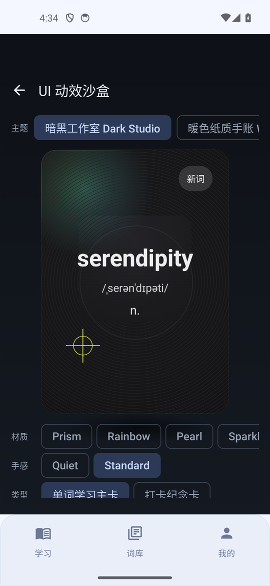 01 首屏 · Dark Studio + Etched</td>
<td align="center">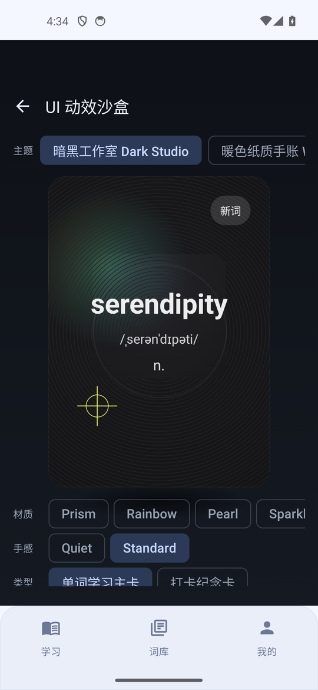 02 翻面 · 正面</td>
<td align="center">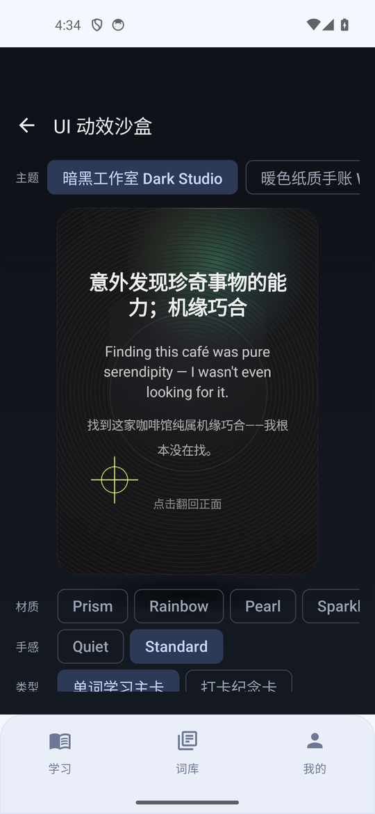 03 翻面 · 背面（释义 + 例句）</td>
</tr>
<tr>
<td align="center">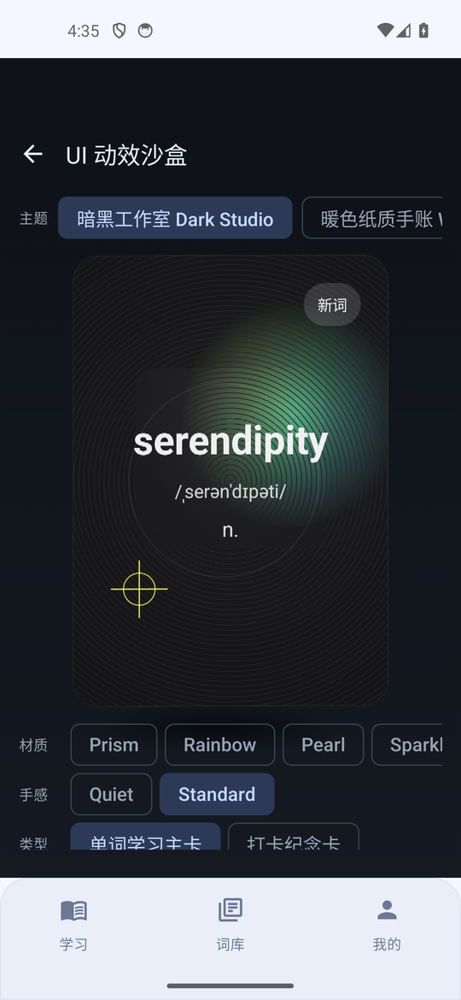 04 拖拽倾斜</td>
<td align="center">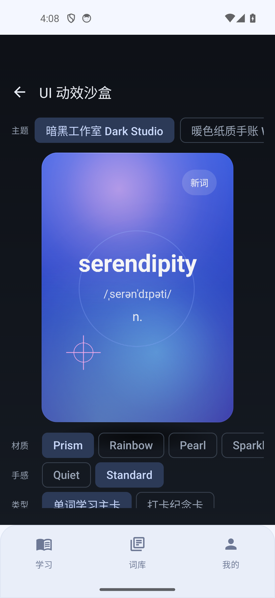 05 材质 · Prism</td>
<td align="center">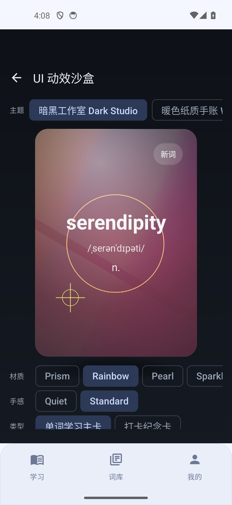 06 材质 · Rainbow</td>
</tr>
<tr>
<td align="center">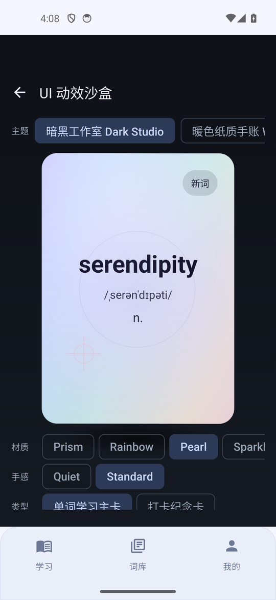 07 材质 · Pearl</td>
<td align="center">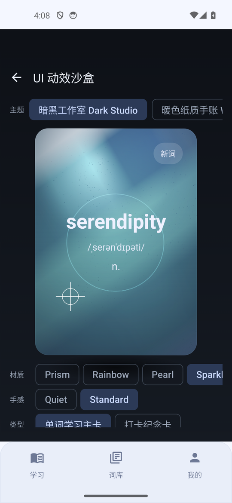 08 材质 · Sparkle</td>
<td align="center">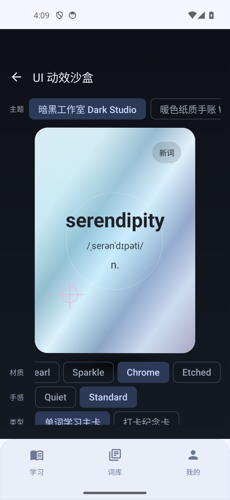 09 材质 · Chrome</td>
</tr>
<tr>
<td align="center">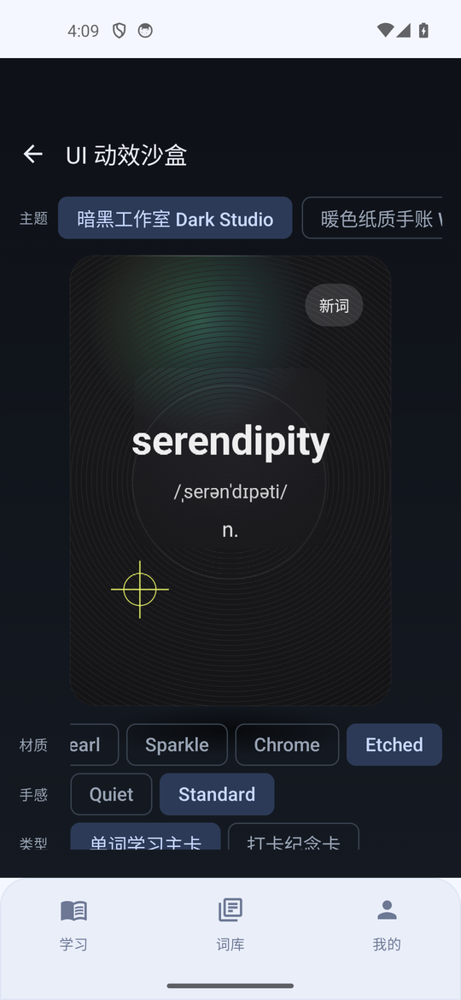 10 材质 · Etched</td>
<td align="center">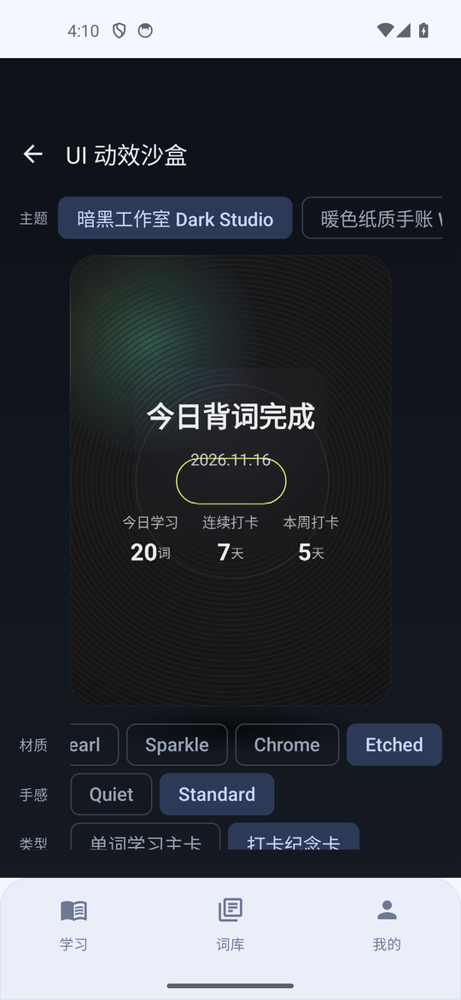 11 打卡纪念卡（同组件另一种 cardKind）</td>
<td></td>
</tr>
</table>

## 4. 动效关键帧（**关键帧拼合，非录屏**）

下面两张 GIF 是把**截图关键帧**按顺序拼起来的示意，不是屏幕录制，帧率/缓动不代表真实手感；真实手感请看 APK。

| 倾斜（before → tilt → settle） | 翻面（front → back） |
|---|---|
| 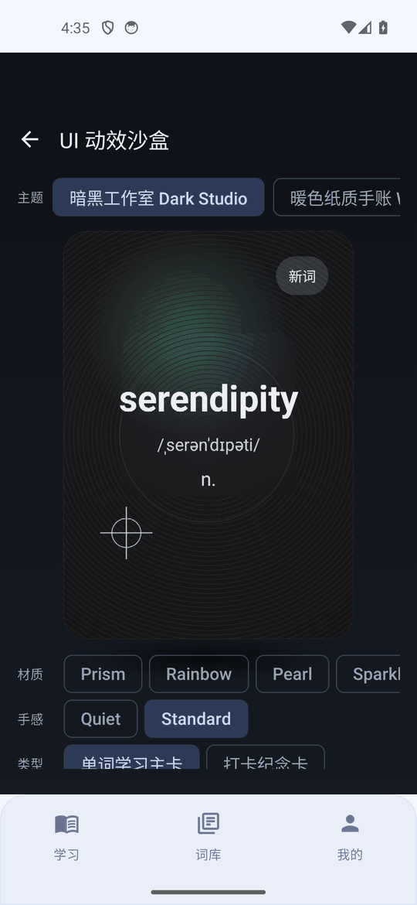 | 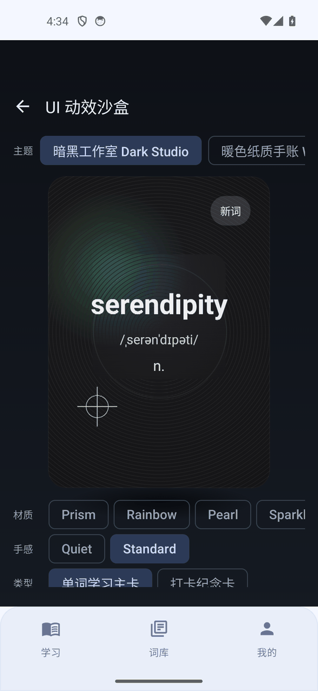 |

## 5. APK 下载（测试预览）

**临时公网直链（Cloudflare 临时隧道）：**

<https://water-rental-collection-bobby.trycloudflare.com/wordhelper-holocard-1.4.7.3preview-vc16.apk>

- 版本：`1.4.7.3preview`，versionCode `16`
- 大小：33,705,004 B（约 32.1 MiB）
- SHA256：`C26ED0F15F5A6BB63F765D3175F936BC486E65490BB44B0C267778ED588A0FD2`
- **临时隧道，可能过期**；过期可让 `ouquan000` 重开一条。拿到 GitHub Release 稳定链接后会把稳定链接放在这一行前面。

安装前请先核对 SHA256，避免拿到半截的下载文件。

## 6. 复现路径

1. 安装上面的 APK（需允许「安装未知来源应用」）。
2. 底部导航进入 **我的**。
3. 点顶部临时入口 **UI 动效沙盒**（即 `/ui-demo` 页面）。
4. 选主题（Dark Studio / Warm Paper）、材质（6 种）、手感（Quiet / Standard）、卡片类型（单词学习卡 / 打卡纪念卡）。
5. 在卡片上**按住拖拽**看 3D 倾斜与箔面跟光；**单击**看 180° 翻面。

## 7. 想请评审者回答的 3 个问题

1. **视觉与材质**：6 种材质的「金属/箔面」质感是否可信？正反面中文/英文文字在各种材质与主题下是否足够清晰、对比度是否够？（尤其 Pearl 与 Sparkle）
2. **动效与性能**：倾斜跟手、眩光跟随、翻面缓动与厚度感是否自然？有没有明显的掉帧风险（纯 Canvas 每帧重绘 + 950 个 glitter 点 + 多层渐变/遮罩）？
3. **代码与接入风险**：`HoloWordCard.kt` 单文件约 1400 行、绘制与状态机混在一起，这样的结构将来接入真实学习卡（真实词条、卡背长内容、无障碍、主题体系）风险在哪？建议怎么切分？

## 8. 已知限制

- **翻面抬升是近似**：Compose 1.6.7 没有 `translationZ`，用 `scale = 1 + 0.025 * sinFlip` 近似「翻面时卡片抬起」，不是真正的 Z 轴位移。
- **阴影可能被裁**：卡片下缘外约 30px 的投影可能被父容器裁切。
- **Sparkle 文本区亮点偏密**：亮片密度在文字区域略高，长文本可读性受影响。
- **背面印章与释义轻微重叠**：印章位置与释义区有轻微压字。
- **Pearl 对比偏弱**：浅色箔面下正文对比度偏低。
- **未验证项**：小屏（< 360dp 宽）、横竖屏旋转、真实帧率/长时间稳定性、系统「移除动画」（`ANIMATOR_DURATION_SCALE=0`，代码里有分支但未专项验证）、键盘弹出场景。
- 截图与数据来自单台测试设备，不代表全部机型。

## 9. 关键文件索引

| 文件 | 说明 |
|---|---|
| `app/src_repo/app/src/main/java/com/kaoyan/wordhelper/ui/component/HoloWordCard.kt` | 组件本体（新）：6 材质配色、箔面/眩光/厚度/阴影绘制、倾斜与翻面状态机、正反面内容与语义 |
| `app/src_repo/app/src/main/java/com/kaoyan/wordhelper/ui/screen/UiDemoScreen.kt` | `/ui-demo` 沙盒页（新）：主题/材质/手感/卡片类型切换 |
| `app/src_repo/app/src/main/java/com/kaoyan/wordhelper/ui/navigation/AppNavigation.kt` | 导航（改）：注册 `ui-demo` 路由 |
| `app/src_repo/app/src/main/java/com/kaoyan/wordhelper/ui/screen/ProfileScreen.kt` | 我的页（改）：顶部临时入口 |

> 导航与 Profile 入口是**临时沙盒入口**，不是最终产品形态；真实接入时会移除或改写。

## 10. 证据摘要

- 独立 device-test（与实现者不同代理）通过项：**翻面 / 倾斜拖拽 / 垂直滚动不误触 / 6 种材质 / 双主题 / 打卡纪念卡** 全部 PASS。
- 独立评分：**85 / 100，PASS**。
- 预览包：`1.4.7.3preview` + versionCode 16，33,705,004 B，
  SHA256 `C26ED0F15F5A6BB63F765D3175F936BC486E65490BB44B0C267778ED588A0FD2`。
- 本次为**测试预览**：未做小屏/旋转/帧率/reduced motion/键盘的专项验证，也未替换真实学习卡。
